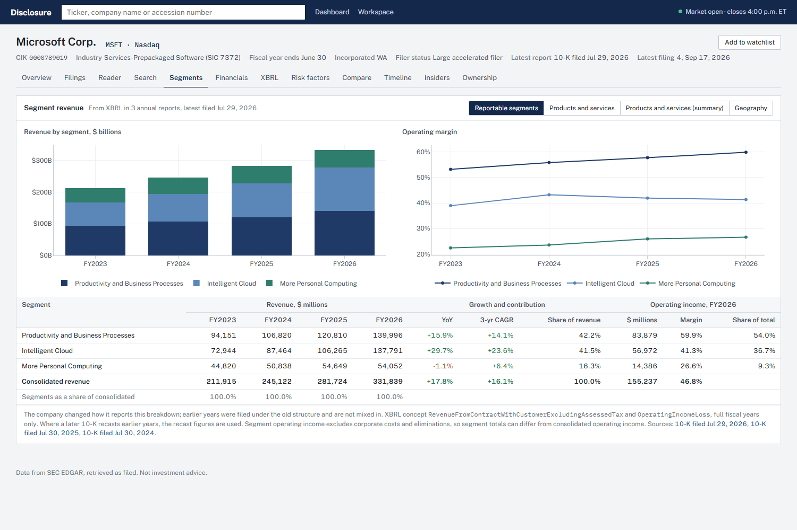
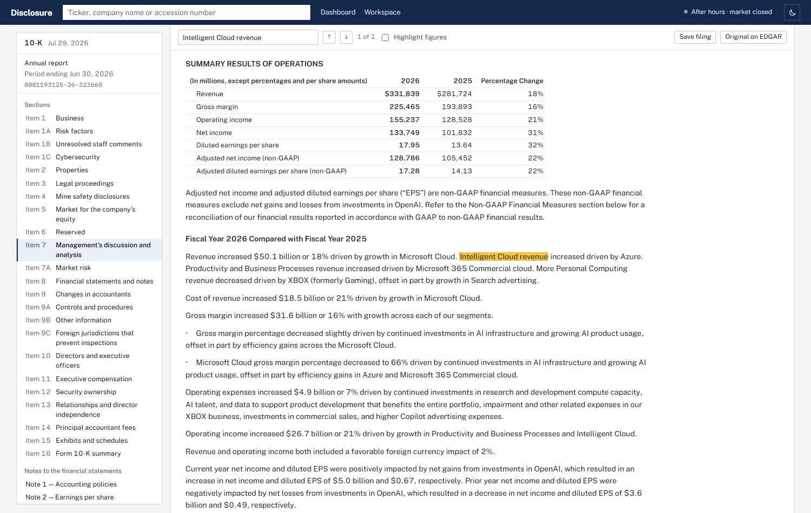
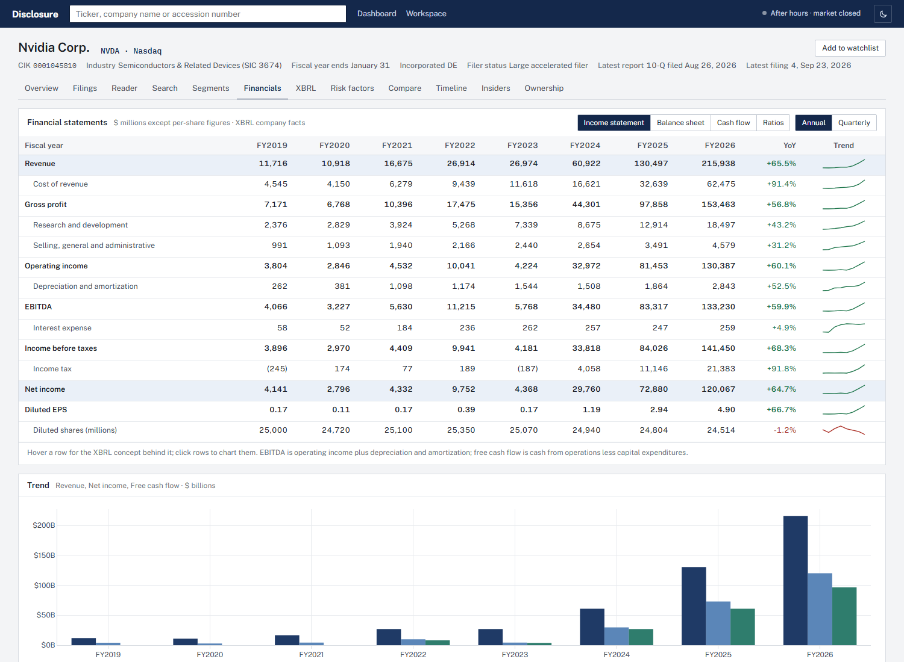
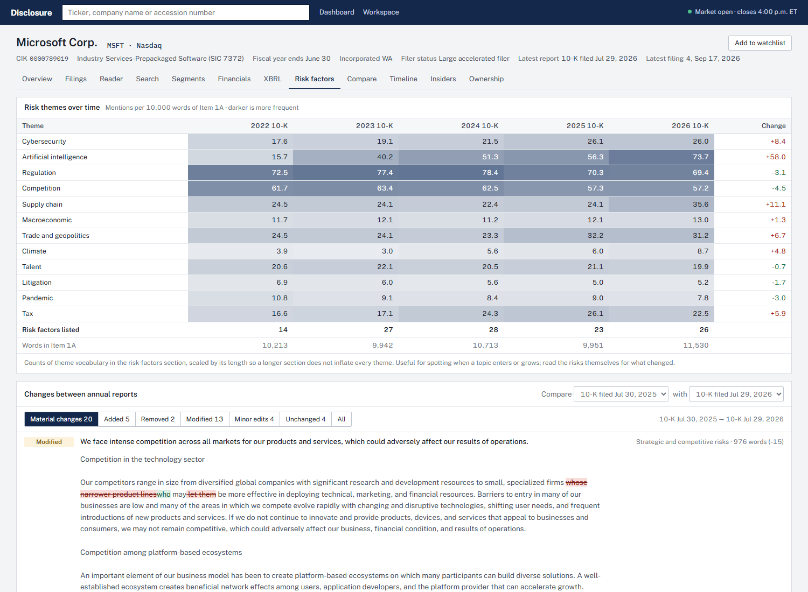
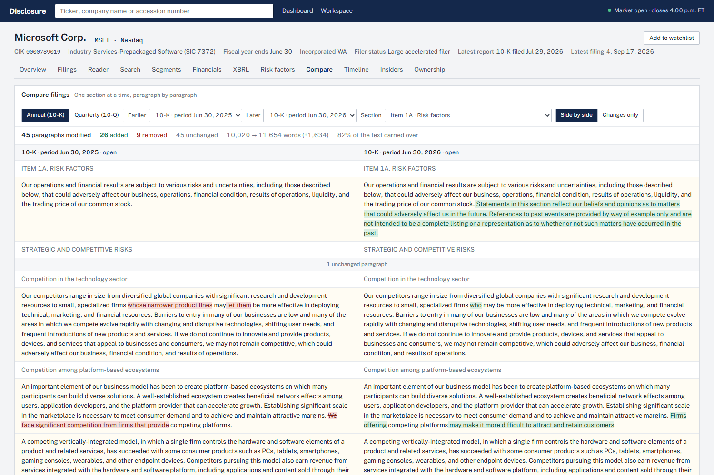
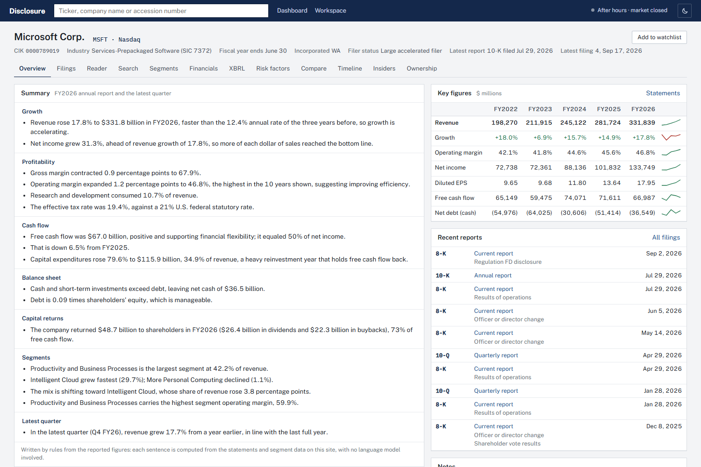
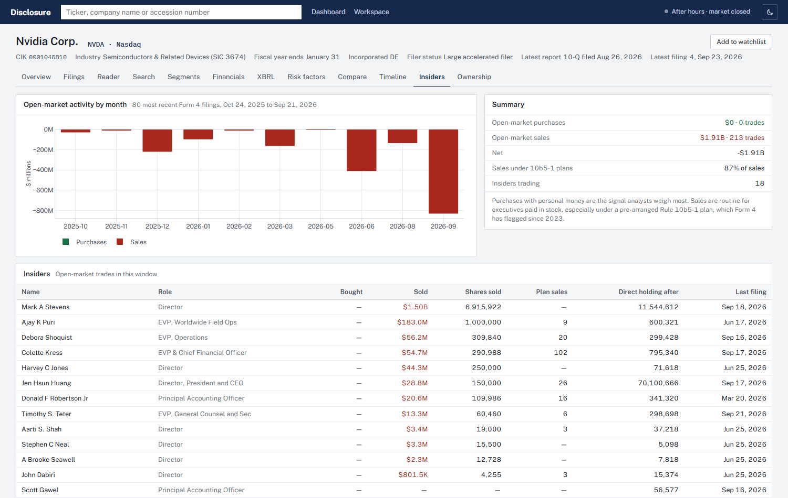
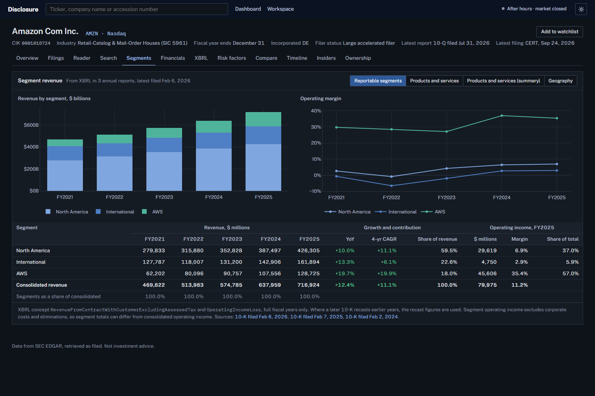

# Disclosure

**A research workstation for SEC filings: search, read, compare and analyze what companies are legally required to disclose.**

**Live demo:** [disclosure-three.vercel.app](https://disclosure-three.vercel.app/)

Disclosure is built around one question: *what is actually happening inside this business, based on what management has to tell the SEC?* Type a ticker, a company name or an accession number and it opens the company's complete filing history. From there you can read any 10-K or 10-Q in a clean reader with section navigation, search every filing since 2001, break revenue down by segment, compare this year's risk factors with last year's word by word, and see what insiders and the largest institutions have been buying and selling.

Everything comes from SEC EDGAR and the SEC's XBRL data. There are no paid APIs, no third-party financial database and no AI model: every number and every sentence of commentary traces back to a filing.



## At a glance

| | |
|---|---|
| **Scope** | A dashboard, a workspace and 12 views per company, from the filing library to 13F ownership |
| **Code** | About 2,800 lines of Python and 1,900 lines of JavaScript and CSS, plus 18 parser tests |
| **Stack** | Python and FastAPI, plain HTML, CSS and JavaScript (no framework, no build step), Plotly, SQLite |
| **Data** | SEC EDGAR only: submissions, XBRL company facts, XBRL instance documents, full-text search, Form 4 and 13F-HR |
| **Parsing** | A filing-HTML cleaner with 10-K/10-Q section detection, a dimensional XBRL reader for segments, a risk factor splitter, a Form 4 parser and a 13F loader |
| **Cost to run** | $0: GitHub and Vercel's free tier |
| **Documentation** | [Architecture](docs/ARCHITECTURE.md), [design decisions](docs/DECISIONS.md) and a [development log](docs/DEVLOG.md) |

## What it does

**Filing library.** Every filing a company has made, over 4,500 for Microsoft, filterable by form group, form type, date range and keyword. 8-K item codes are translated into plain English, so "5.02" reads as "Officer or director change".

**Filing reader.** Filings open inside the app. The raw EDGAR HTML (8.6 MB for Microsoft's latest 10-K) is rebuilt as clean paragraphs and tables of about 0.4 MB. Item headings are detected, including Risk Factors, MD&A, Market Risk and Legal Proceedings, and every note to the financial statements is listed, with the segment note highlighted. It has in-document search and an option to highlight every dollar amount and percentage.



**Search across filings.** Search a phrase across every filing since 2001 through EDGAR full-text search, with highlighted excerpts that open the filing at the passage. A documents-per-year chart shows when a topic entered the filings: Microsoft's first 10-K or 10-Q to mention "artificial intelligence" was in 2017.

**Segment revenue explorer.** Revenue and operating income by reportable segment, product line and region, read from the XBRL inside each 10-K. It covers Microsoft's Intelligent Cloud, Alphabet's Google Cloud and Other Bets, Amazon's AWS, Apple's iPhone and Services, and so on, with growth, share of revenue, operating margin and up to five years of history. When a company recasts its segments, older years under the previous structure are not mixed in.

**Financial statements.** Ten years of income statement, balance sheet, cash flow and ratios, annual or quarterly, with EBITDA and free cash flow derived. Per-share figures are adjusted for stock splits, which are detected from the filings themselves. Hover any line to see the XBRL concept behind it.



**XBRL explorer.** Every concept a company has reported, searchable by label or tag, with every fact as filed and the SEC frame used for cross-company comparison. A reporting-structure panel shows how one filing's XBRL is organized: statements, notes and detail tables, and how many line items are company extensions rather than standard taxonomy.

**Risk factor analysis.** Item 1A is split into individual risks, and two years are compared risk by risk: added, removed, modified or unchanged, with a word-level diff. A theme table tracks cybersecurity, AI, regulation, supply chain, trade and seven other themes across five years. In Microsoft's risk factors, AI vocabulary rose from 16 to 74 mentions per 10,000 words between the 2022 and 2026 10-Ks.



**Filing comparison.** Any section of two 10-Ks or 10-Qs side by side, with paragraphs aligned by content so edited text is paired with its earlier version. New language is green and removed language is red, as in document review software.



**Summary.** Each company opens with analyst-style commentary written by rules from the statements and segment data:
- growth against the prior trend
- margins against their ten-year range
- cash conversion and reinvestment
- leverage and capital returns
- segment mix and the latest quarter

Banks get their own rules, because debt ratios built for industrial companies mislead for a balance sheet funded by deposits.



**Timeline, insiders and ownership.**
- **Timeline:** classifies filings into reports, earnings, deals, capital raises, leadership changes, governance and large-shareholder filings.
- **Insiders:** parses Form 4 filings into purchases and sales by month and by insider, flagging trades made under Rule 10b5-1 plans.
- **Ownership:** shows the positions of 36 of the largest 13F filers and how they changed last quarter.



**Workspace.** A watchlist, saved filings, company notes, and research ideas with a thesis and a stage. Everything is stored in the browser with no login and can be exported as a file.

**Light and dark themes.** A toggle in the top bar switches every page, chart and diff view. The choice is remembered and applied before the first paint, so pages never flash the wrong theme.



## How it works

```
Browser (HTML, CSS, JS modules)          FastAPI on Vercel (Python)                  SEC
───────────────────────────────          ──────────────────────────                  ───
hash router, one module per view  ──►    /api/* route handlers                ──►    data.sec.gov submissions, company facts
Plotly charts, loaded on demand          throttled client, ≤ 10 requests/s           sec.gov/Archives filings, XBRL instances
localStorage workspace                   SQLite cache (HTTP bodies, parsed results)  efts.sec.gov full-text search
                                         data/13f.db (prebuilt, 36 managers)
```

A request for a filing downloads it once, through a throttled client that identifies itself with a User-Agent as the SEC requires. The response body is cached in SQLite, parsed into blocks, and the parsed result is cached too. Filings never change after they're accepted, so parsed filings are kept for a month. Responses also carry CDN cache headers, so repeat views never reach the server. The [architecture document](docs/ARCHITECTURE.md) covers each pipeline in detail.

## Engineering notes

Most of the work was handling how differently companies file the same information. A few examples:

- **Tables of contents and page headers repeat every heading.** To find where Item 7 actually starts, the parser prefers headings that carry a title and are followed by the most text before a different Item begins. Microsoft repeats "PART II / Item 7" at the top of every page, which broke the first version.
- **Companies tag the same revenue twice.** Microsoft reports its product lines and also Product vs. Service; Amazon reports store types and also product vs. service sales. Both breakdowns add up to total revenue, so each becomes its own view. Apple tags "Products" and also iPhone, Mac and iPad. Subtotals are nested only when the sum holds in two consecutive years, which rules out coincidences like NVIDIA's small OEM line happening to fit within rounding.
- **Stock splits.** Per-share history is restated after a split, but years that only appear in older filings are not. Splits are found where a later filing restates a period by a split ratio. A period reported before and after both of Tesla's splits shows a ratio of 15; that is recognized as the product of the 5-for-1 and the 3-for-1, not a third split.
- **13F edge cases.** T. Rowe Price still reports values in thousands, JPMorgan refiled its complete holdings as an amendment, and Norges Bank filed an empty report under confidential treatment. Each would have produced a wrong number without a specific check.
- **Serverless event loops.** The HTTP client was tied to the first event loop, so on a runtime that starts a new loop per request, every request after the first failed. It is now rebound per loop. A test in Vercel mode caught this before deployment.

Every decision, with the alternatives considered, is in [DECISIONS.md](docs/DECISIONS.md).

## Data sources

| Source | Used for |
|---|---|
| EDGAR submissions API | Company profile, the complete filing index, 8-K item codes |
| XBRL company facts API | Financial statements, the XBRL explorer |
| XBRL instance documents and MetaLinks.json | Segment, product and geographic revenue; filing structure |
| Filing documents (HTML) | The reader, section comparison, risk factors, search excerpts |
| EDGAR full-text search | Search across filings since 2001, accession number lookup |
| Form 4 XML | Insider transactions |
| 13F-HR information tables | Institutional ownership (prebuilt by `scripts/build_13f.py`) |
| EDGAR current-events feed | Latest filings on the dashboard |

## Run it locally

You need Python 3.10 or newer.

```bash
git clone https://github.com/btx-dysmas/disclosure.git
cd disclosure
pip install -r requirements.txt
export SEC_USER_AGENT="Your Name you@example.com"
python -m uvicorn api.index:app --port 8000
```

On Windows Command Prompt, use `set SEC_USER_AGENT=Your Name you@example.com` instead of `export`. Then open http://localhost:8000. The SEC asks every automated client to identify itself with a name and email; without `SEC_USER_AGENT`, a generic placeholder is sent.

Run the tests:

```bash
pip install -r requirements-dev.txt
python -m pytest
```

Refresh the 13F database (a GitHub Action also does this each quarter):

```bash
python scripts/build_13f.py
```

## Deploy (free)

1. Push the repository to GitHub.
2. Import it at [vercel.com/new](https://vercel.com/new). Vercel detects the FastAPI app in `api/index.py` and sends requests to it, and the front end in `public/` is served as static files.
3. Add `SEC_USER_AGENT` under **Settings → Environment Variables**.

## Project structure

```
api/index.py            Vercel entry point
disclosure/             the FastAPI app and every parser
  sec.py, store.py        throttled EDGAR client, SQLite cache
  document.py             filing HTML to clean blocks, section detection
  segments.py             segment revenue from XBRL instances
  financials.py           standardized statements, split adjustment
  risk.py, diff.py        risk factor splitting and comparison
  compare.py, search.py   filing comparison, full-text search
  insiders.py, ownership.py, timeline.py, xbrl.py, insights.py
public/                 index.html, css/app.css, js/ (one module per view)
scripts/build_13f.py    builds data/13f.db
tests/                  parser tests on small inline examples
docs/                   architecture, decisions, development log, screenshots
```

## Limitations

- **IFRS filers:** statements and segments cover US-GAAP filers only. Foreign issuers reporting under IFRS still get their filings and search, but no standardized statements.
- **Segment tagging:** segment extraction depends on how a company tags its XBRL. Where tags overlap in ways that can't be separated, the page shows the figures as filed and says so.
- **Ownership coverage:** ownership covers 36 of the largest managers, not all of the roughly 7,000 quarterly 13F filers.
- **Cold starts:** on Vercel the SQLite cache lives in `/tmp` and lasts only as long as a function instance, so the first view of a large filing takes a few seconds.

## Background

I started Disclosure in January 2025 as a small FastAPI service for looking up companies and their filings, alongside Intrinsic, my equity research terminal, which also uses SEC data. It grew into this because the most useful things I found in a 10-K were rarely numbers I could get from a data provider: a new risk factor, a reworded paragraph in MD&A, a segment growing faster than the rest.

The commit history covers the current build.

## Disclaimer

Disclosure is an educational project. It presents SEC filings as filed and is not investment advice.

## Author

**Noah Williams** (Dysmas Anastasiou)
Email: noah.w.williams@protonmail.com
